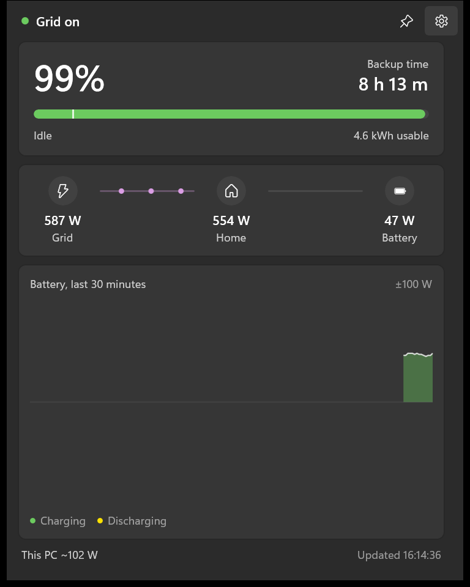

# Power Monitor

Power Monitor is a Windows notification-area app for a Deye hybrid inverter on the local network. It shows battery state of charge, whether the pack is charging or discharging, apartment load, how long backup would last if the grid dropped now, and this PC’s own power draw.



The flyout is compact and stays out of Alt+Tab. Left-click the tray icon to show or hide it. Press Esc or click outside to hide it, unless it is pinned. Right-click the icon for Settings or Exit. Starting the app again focuses the copy that is already running. Settings and Find logger open as their own windows.

## Requirements

- 64-bit Windows 10 version 1809 or later
- The [.NET 8 SDK](https://dotnet.microsoft.com/download/dotnet/8.0). `global.json` asks for SDK 8.0.100 and rolls forward to the latest 8.0 feature band
- A Deye logger on the same LAN

Current Modbus TCP loggers use port 502 and unit id 1. On firmware 1.7.x, turn Modbus TCP on for Link 2 and leave Deye Cloud on Link 1. Older sticks use Solarman V5 on port 8899 and the serial printed on the stick.

This PC’s watts come from LibreHardwareMonitor: PawnIO for AMD package power and the NVIDIA libraries for GPU power, plus a baseline you can set in Settings (40 W by default). If either reading is missing, that part of the PC total stays empty.

## Download

The current build is on the [releases page](https://github.com/aqua1907/power-consumption-monitor-app/releases). Download `PowerMonitor-win-x64.zip`, extract the whole folder, and run `PowerMonitor.exe`. The .NET runtime is included. A single extracted exe, without the files next to it, will not start.

## Run

From the repository root:

```powershell
dotnet run --project src\PowerMonitor
```

On first launch, open Settings and enter the logger address, or use Find logger to pick one on the network. The app reads immediately, then about every 10 seconds. Saving settings starts a new read right away.

While the grid is up, backup time is the time that would remain if the grid dropped now. It uses the pack capacity (5.12 kWh per pack), the reserve (10% by default), and the apartment load reported by the inverter. Loads under 50 W show as Idle. Notifications can fire when the grid drops and when the battery crosses 20%.

If the state of charge looks wrong, change the register address offset in Settings. If charge and discharge are reversed, flip the power sign.

Settings are stored in `%AppData%\PowerMonitor\settings.json` on this PC and are not part of the repository. If the app fails before the tray icon appears, the exception is written to `%LocalAppData%\PowerMonitor\startup-error.txt`.

## Tests

```powershell
dotnet test PowerMonitor.sln
```
